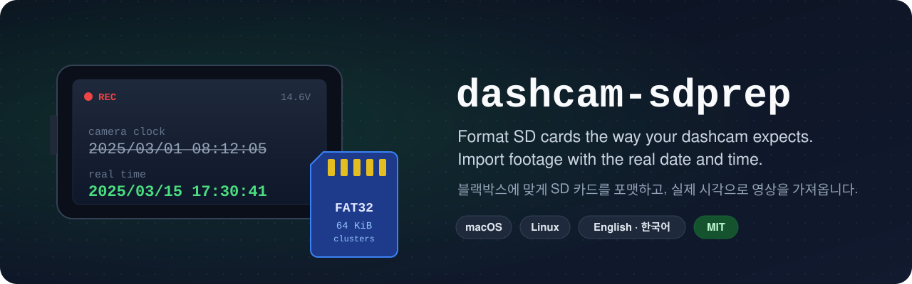
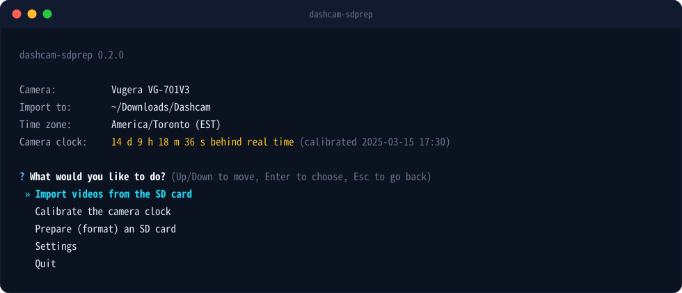
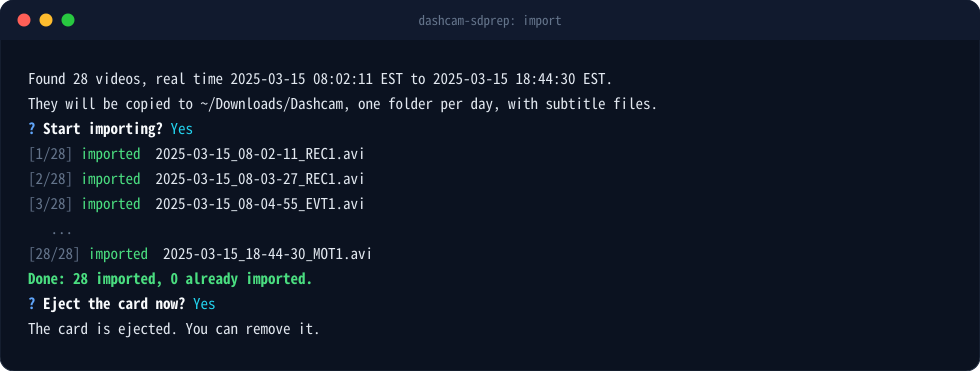
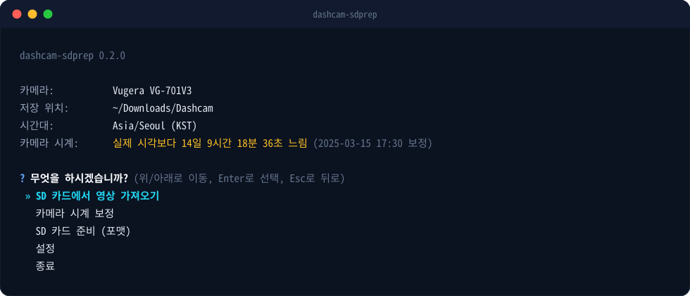
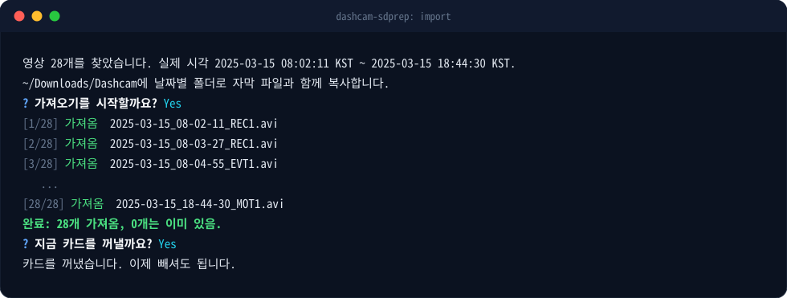

<p align="center">
  
</p>

<p align="center">
  <a href="https://github.com/LevelThreeCo/dashcam-sdprep/actions/workflows/test.yml"></a>
  
  
  <a href="LICENSE"></a>
</p>

<p align="center">
  <b>English</b> &nbsp;·&nbsp; <a href="#korean">한국어</a>
</p>

---

## Install in one line

Open **Terminal** (macOS) or a terminal window (Linux), paste this, and press Enter:

```sh
curl -fsSL https://raw.githubusercontent.com/LevelThreeCo/dashcam-sdprep/main/install.sh | bash
```

It installs everything it needs into its own folder (no administrator password, nothing
system-wide) and opens the menu straight away. Next time, just type `dashcam-sdprep`.

<p align="center">
  
</p>

**Up / Down** to move &nbsp;·&nbsp; **Enter** to choose &nbsp;·&nbsp; **Esc** to go back &nbsp;·&nbsp; **Quit** is always the last item

## Why this exists

Many dashcams refuse a memory card that every computer says is fine, then ask you to format it on
the camera. If the camera's touchscreen or buttons are broken, you are stuck. Its clock may be
wrong too, so every video is stamped with the wrong date and time.

The cause is usually one exact detail inside the camera's firmware. The Vugera VG-701V3, for
example, only accepts **FAT32 with 64 KiB clusters**. Ordinary formatters (SD Card Formatter,
macOS Disk Utility, Windows) pick a different cluster size, or exFAT on large cards, so the camera
rejects them every time. This project reads what the firmware actually checks, writes it down as a
camera **profile**, and formats cards to match.

## What it does

<table>
  <tr>
    <td width="50%" valign="top">
      <h3>Prepare SD cards</h3>
      Formats a card exactly the way the camera's firmware expects, then reads it back to prove it
      passes the same checks the camera runs. Only removable SD/USB cards are ever offered, and
      nothing is erased until you type the card's name.
    </td>
    <td width="50%" valign="top">
      <h3>Import with the real time</h3>
      Copies your videos into one folder per day, named by the <b>real</b> start time, each with a
      subtitle file that shows the real time while it plays. Every copy is checked against the
      original. Already-imported videos are skipped. The card itself is never changed.
    </td>
  </tr>
  <tr>
    <td width="50%" valign="top">
      <h3>Fix a wrong camera clock</h3>
      Tell it once what the camera showed at a known moment: type the time you see on its screen,
      or pick a phone photo of the screen. Every import after that is corrected automatically,
      in whatever time zone you choose.
    </td>
    <td width="50%" valign="top">
      <h3>Simple, and safe to stop</h3>
      Menus in English or Korean, a folder picker you drive with the keyboard, and settings that
      are remembered. Esc always goes back, and stopping halfway never leaves a half-copied file.
    </td>
  </tr>
</table>

<p align="center">
  
</p>

## Getting started

1. **Install** with the line above. The menu opens and asks which language to use.
2. **Prepare your card.** Choose *Prepare (format) an SD card*, pick the card, and type its name to
   confirm. Then put the card straight into the camera.
3. **Calibrate the clock** (once). Choose *Calibrate the camera clock*, then either:
   - *I can see the camera screen right now*: type a time a few seconds ahead of what the screen
     shows, and press Enter at the exact second the screen reaches it, or
   - *I have a photo of the camera screen*: pick the photo and type the time visible in it.
4. **Import.** Put the card in your computer and choose *Import videos from the SD card*. Your
   videos appear in the import folder, by day, with the real time.

Repeat the calibration now and then, and after the car battery has been disconnected, to catch any
drift in the camera's clock.

## Supported cameras

| Camera | Firmware | Card rules | Evidence |
|---|---|---|---|
| Vugera VG-701V3 | 1.0.3 (tested on a camera), 1.0.4 (analysed) | MBR, FAT32, 64 KiB clusters, cards of 4.3 GB or more | [notes](docs/profiles/vugera-vg-701v3.md) |

Have a different camera? A profile is a small JSON file plus a write-up of the evidence. See
[CONTRIBUTING.md](CONTRIBUTING.md).

## More

- **[Command reference](docs/usage.md):** `list`, `verify`, `format`, `timefix` and `profiles`, for
  scripting or for checking a card without the menu.
- **Update:** run the install line again. **Uninstall:** add `-s -- --uninstall` after `bash`.
- **Requirements:** macOS or Linux with Python 3.9+ (the installer checks and tells you exactly what
  to install if anything is missing). Formatting on Linux also needs `dosfstools`. Windows is not
  supported.
- **Your settings** live in `~/Library/Application Support/dashcam-sdprep/` (macOS) or
  `~/.config/dashcam-sdprep/` (Linux).

## License and disclaimer

[MIT](LICENSE), copyright (c) 2026 LevelThree Co Inc.

> [!WARNING]
> **Provided as is, with no warranty, no support and no liability.** Formatting erases the card you
> choose. You are responsible for choosing the right card and for keeping copies of anything you
> need. This project is not affiliated with, endorsed by, or supported by any camera or memory-card
> maker; product names only identify which device a profile is for.

<br>

---

<a id="korean"></a>

<p align="center">
  <a href="#install-in-one-line">English</a> &nbsp;·&nbsp; <b>한국어</b>
</p>

## 한 줄로 설치하기

**터미널**(macOS) 또는 터미널 창(Linux)을 열고, 아래 한 줄을 붙여넣은 뒤 Enter를 누르세요.

```sh
curl -fsSL https://raw.githubusercontent.com/LevelThreeCo/dashcam-sdprep/main/install.sh | bash
```

필요한 모든 것을 전용 폴더에 설치하며(관리자 암호 불필요, 시스템 전체에 설치하지 않음), 설치가 끝나면
바로 메뉴가 열립니다. 다음부터는 `dashcam-sdprep`만 입력하면 됩니다.

<p align="center">
  
</p>

**위 / 아래**로 이동 &nbsp;·&nbsp; **Enter**로 선택 &nbsp;·&nbsp; **Esc**로 뒤로 &nbsp;·&nbsp; **종료**는 항상 마지막 항목

## 왜 만들었나요

많은 블랙박스는 컴퓨터에서 문제없이 포맷한 메모리 카드도 거부하고, 카메라에서 다시 포맷하라고 요구합니다.
그런데 블랙박스의 터치스크린이나 버튼이 고장 났다면 방법이 없습니다. 시계까지 틀려 있으면 모든 영상에
잘못된 날짜와 시각이 찍힙니다.

원인은 대개 블랙박스 펌웨어가 확인하는 아주 구체적인 조건 하나입니다. 예를 들어 Vugera VG-701V3는
**64 KiB 클러스터의 FAT32**만 받아들입니다. 일반 포맷 도구(SD Card Formatter, macOS 디스크 유틸리티,
Windows)는 다른 클러스터 크기를 쓰거나 대용량 카드를 exFAT으로 포맷하기 때문에 블랙박스가 매번 거부합니다.
이 프로젝트는 펌웨어가 실제로 무엇을 확인하는지 분석해 카메라별 **프로필**로 정리하고, 그에 맞게 카드를
포맷합니다.

## 주요 기능

<table>
  <tr>
    <td width="50%" valign="top">
      <h3>SD 카드 준비</h3>
      블랙박스 펌웨어가 기대하는 방식 그대로 카드를 포맷한 뒤, 카메라가 하는 것과 같은 검사를 통과하는지
      다시 읽어서 확인합니다. 이동식 SD/USB 카드만 선택할 수 있으며, 카드 이름을 직접 입력하기 전에는
      아무것도 지우지 않습니다.
    </td>
    <td width="50%" valign="top">
      <h3>실제 시각으로 가져오기</h3>
      영상을 날짜별 폴더에 <b>실제</b> 시작 시각 이름으로 복사하고, 재생할 때 실제 시각을 보여주는
      자막 파일을 함께 만듭니다. 모든 복사본은 원본과 대조해 확인하며, 이미 가져온 영상은 건너뜁니다.
      카드 자체는 절대 변경하지 않습니다.
    </td>
  </tr>
  <tr>
    <td width="50%" valign="top">
      <h3>틀린 블랙박스 시계 보정</h3>
      특정 순간에 블랙박스가 표시한 시각을 한 번만 알려주세요. 화면에 보이는 시각을 입력하거나, 화면을 찍은
      휴대폰 사진을 선택하면 됩니다. 이후의 모든 가져오기가 원하는 시간대에 맞게 자동으로 보정됩니다.
    </td>
    <td width="50%" valign="top">
      <h3>간단하고, 언제 멈춰도 안전</h3>
      영어와 한국어 메뉴, 키보드로 조작하는 폴더 선택, 저장되는 설정. Esc는 언제나 뒤로 가기이며,
      중간에 멈춰도 반쯤 복사된 파일이 남지 않습니다.
    </td>
  </tr>
</table>

<p align="center">
  
</p>

## 시작하기

1. 위의 한 줄로 **설치**합니다. 메뉴가 열리면 언어를 선택하세요.
2. **카드 준비.** *SD 카드 준비 (포맷)*을 선택하고 카드를 고른 뒤, 카드 이름을 입력해 확인합니다.
   그런 다음 카드를 바로 블랙박스에 넣으세요.
3. **시계 보정** (한 번만). *카메라 시계 보정*을 선택한 뒤 다음 중 하나를 고르세요.
   - *지금 카메라 화면을 볼 수 있음*: 화면에 표시된 시각보다 몇 초 뒤의 시각을 입력하고, 화면이 정확히
     그 시각이 되는 순간 Enter를 누릅니다.
   - *카메라 화면을 찍은 사진이 있음*: 사진을 선택하고 사진 속 화면에 보이는 시각을 입력합니다.
4. **가져오기.** 카드를 컴퓨터에 넣고 *SD 카드에서 영상 가져오기*를 선택합니다. 영상이 실제 시각
   기준으로 날짜별로 저장 폴더에 정리됩니다.

블랙박스 시계가 조금씩 어긋날 수 있으니 가끔, 그리고 차량 배터리를 분리한 뒤에는 다시 보정하세요.

## 지원 기종

| 기종 | 펌웨어 | 카드 조건 | 근거 자료 |
|---|---|---|---|
| Vugera VG-701V3 | 1.0.3 (실제 기기에서 확인), 1.0.4 (분석) | MBR, FAT32, 64 KiB 클러스터, 4.3 GB 이상 카드 | [분석 노트 (영문)](docs/profiles/vugera-vg-701v3.md) |

다른 기종을 쓰시나요? 프로필은 작은 JSON 파일과 근거 자료 설명으로 이루어집니다.
[CONTRIBUTING.md](CONTRIBUTING.md) (영문)를 참고하세요.

## 더 알아보기

- **[명령어 설명서 (영문)](docs/usage.md):** 스크립트용 또는 메뉴 없이 카드를 확인할 때 쓰는 `list`,
  `verify`, `format`, `timefix`, `profiles` 명령.
- **업데이트:** 설치 명령을 다시 실행하세요. **삭제:** `bash` 뒤에 `-s -- --uninstall`을 붙여 실행합니다.
- **요구 사항:** Python 3.9 이상이 설치된 macOS 또는 Linux (설치 프로그램이 확인하고, 부족한 것이 있으면
  설치 방법을 정확히 알려줍니다). Linux에서 포맷하려면 `dosfstools`도 필요합니다. Windows는 지원하지 않습니다.
- **설정 파일 위치:** `~/Library/Application Support/dashcam-sdprep/` (macOS) 또는
  `~/.config/dashcam-sdprep/` (Linux).

## 라이선스 및 고지

[MIT](LICENSE), copyright (c) 2026 LevelThree Co Inc.

> [!WARNING]
> **있는 그대로 제공되며, 어떠한 보증, 지원, 책임도 지지 않습니다.** 포맷하면 선택한 카드의 내용이 모두
> 지워집니다. 올바른 카드를 선택하고 필요한 파일을 미리 백업하는 것은 사용자의 책임입니다. 이 프로젝트는
> 어떤 블랙박스 제조사나 메모리 카드 제조사와도 관련이 없으며, 보증이나 지원을 받지 않습니다. 제품 이름은
> 프로필이 어떤 기기용인지 나타내기 위해서만 사용됩니다.
